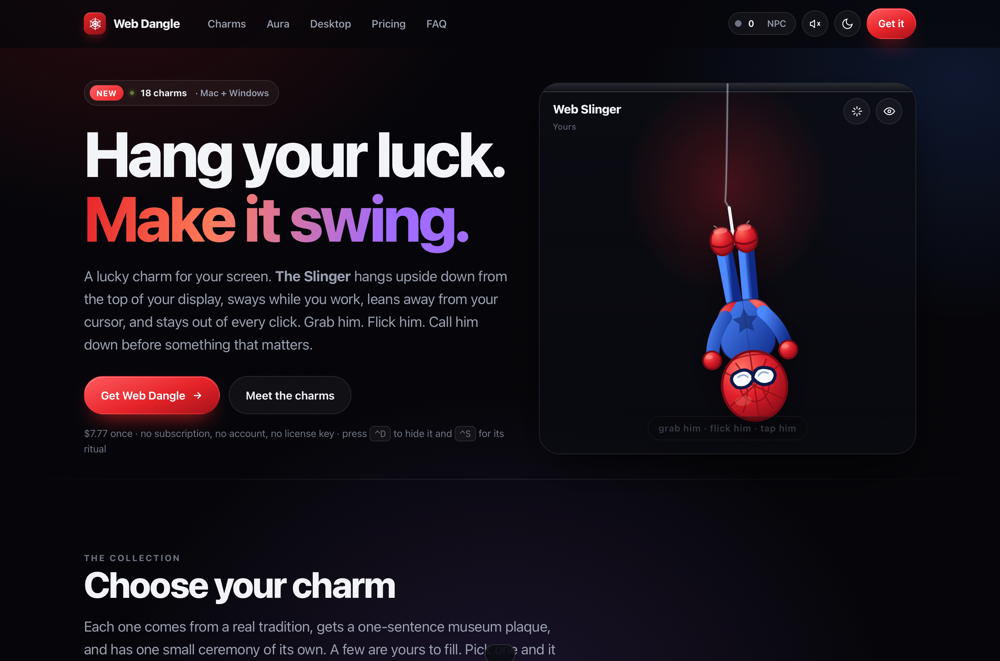

# Web Dangle

> A lucky charm for your screen. The Slinger hangs upside down from the top of your
> display, sways while you work, leans away from your cursor, and stays out of every
> click. Grab him, flick him, call him down before something that matters.

A complete, working product: an 18-charm collection, a live Verlet rope solver, a
zero-build marketing site, and a real macOS menu-bar app.



---

## Run it

### The website

No install, no build step, no dependencies.

```bash
scripts/serve.sh          # http://127.0.0.1:8765/
```

Or just open `web/index.html` in a browser. It is plain HTML, CSS and ES modules —
it works from `file://` too.

### The macOS app

```bash
macos/build.sh            # builds ./build/WebDangle.app
macos/build.sh --run      # …and launches it
```

Then look in your menu bar. Shortcuts:

| Keys | What |
|---|---|
| `⌃D` | Show / hide the charm |
| `⌃S` | Perform its ritual |
| `⌃F` | Flick it |
| `⌘0` | Re-centre it on screen |

```bash
open 'webdangle://bless'    # drop in and perform the ritual
open 'webdangle://charm?id=boba'
```

### Tests

```bash
node scripts/test-physics.mjs    # the rope solver: 7 checks
node scripts/test-charms.mjs     # all 18 charms: ~95 checks
```

---

## What is in here

```
PLAN.md                  the product and engineering plan, start to finish
web/                     the site — zero build step
  index.html             the marketing page
  charm.html             transparent charm-only surface, hosted by the app
  charm.css              rig styles, shared by both pages
  styles.css             site chrome
  js/verlet.js           the rope solver
  js/dangle.js           the rig: wind, cursor-lean, grab, flick, rituals
  js/charms.js           18 charms — artwork and rituals
  js/sound.js            every noise, synthesised. zero audio files
  js/aura.js             the aura meter
  js/app.js              site boot
macos/                   the native app
  build.sh               compile + assemble + ad-hoc sign the .app
  Sources/WebDangle/     Swift
scripts/
  serve.sh               local static server
  shot.sh                headless screenshot (see the caveat below)
  test-physics.mjs       solver tests
  test-charms.mjs        charm integrity tests
shots/                   rendered proof, captured by the app itself
```

---

## The two decisions that shape everything

### 1. One engine, two hosts

The rope physics and the charm artwork are written **once**, in JavaScript, and used
by both the website and the native app. The app hosts the identical engine inside a
transparent `WKWebView`; Swift owns only what the web cannot do — the menu bar, the
click-through window, global hotkeys, launch-at-login, and the `webdangle://` scheme.

The alternative, reimplementing each charm in SwiftUI, means drawing eighteen charms
twice and maintaining two physics solvers that will drift. Here, adding a charm is a
one-file change that ships to the site and the app at the same time, and the app can
never look different from the page.

### 2. The hero is original, on purpose

Spider-Man is Marvel and Disney intellectual property. Shipping his name and suit
would be infringement and takedown-bait on day one. So the hero is **The Slinger** —
an original masked web-slinger drawn from scratch as SVG for this project, with his
own proportions, lenses and chest mark. He hangs upside down because that is the
joke, not because he belongs to anyone else.

The name Spider-Man appears nowhere in the product, the code, or the copy. A licensed
or commissioned character can be dropped into `web/js/charms.js` without touching
the engine.

---

## How the rope works

Position-based Verlet integration:

```
x(t+dt) = 2·x(t) − x(t−dt) + a(t)·dt²
```

Each node stores only its current and previous position; velocity is the displacement
between them. Constraints are then relaxed over N passes, weighted by inverse mass, so
the heavy charm pulls the light cord rather than the other way round.

Three details are doing real work, and all three were found by tests rather than by
looking at it:

**The cord must never stretch.** Gauss-Seidel relaxation gets close in a fixed pass
count, but a hard drag leaves a few percent of strain, which reads as elastic. After
the fixed passes, `step()` measures the worst segment and keeps relaxing until it is
within 1.5%. On a resting charm the loop exits immediately; under a violent whip it
runs more. Measured worst case across a 3000-frame torture test: **1.5%**.

**The grab target is clamped, not the result.** If the tip is allowed past the
cord's reach, the constraint system becomes infeasible and the solver resolves the
conflict by stretching. Clamping the pointer target to the reachable disc first means
the cord simply goes taut and the charm stops dead at the end of it, the way a real
charm on a real string behaves.

**The charm's angle comes from a multi-node baseline.** Taken from the final segment
alone, the heavy tip's lag turns into a hard kink and the charm hangs at a visibly
wrong angle — measured at **28°** before this was changed. Averaged over the last few
nodes it reads as the real direction of the cord, and the idle sway sits at a gentle
6–9°.

Run `node scripts/test-physics.mjs` to see all of it asserted.

---

## How click-through works

The hard requirement is that the charm must be grabbable while **everything else
clicks straight through**. A window either takes mouse events or it does not, and a
full-screen overlay that takes them would swallow the whole desktop.

1. The window is borderless, transparent, `level = .floating`, and
   `ignoresMouseEvents = true`. Every click passes to whatever is underneath.
2. The page reports the charm's real on-screen rectangle ten times a second.
3. **Global** mouse-moved monitors track the pointer while the window is inert.
   Global monitors do not fire for events delivered to our own app, so a **local**
   monitor covers the case where the window is currently accepting events. Both feed
   the same function.
4. When the pointer is inside that rectangle the window stops ignoring mouse events;
   when it leaves — or the moment the charm is dropped — it goes straight back to
   inert. While a drag is in progress the window is pinned open, otherwise a fast
   flick would hand the pointer back mid-grab.

Net result: the charm is the only pixel on the screen that can consume a click.

Two supporting details: the window refuses key status (`canBecomeKey = false`) so
clicking the charm never steals focus from whatever you are actually working in, and
the web view accepts the first click (`acceptsFirstMouse`) so a grab is not swallowed
as an activation click.

Hotkeys use Carbon's `RegisterEventHotKey` rather than an event monitor, because
global key monitors *do* require Accessibility permission and would greet a first
launch with a system dialog for what is, ultimately, a lucky charm.

---

## Adding a charm

A charm is one object in `web/js/charms.js`:

```js
{
  id: 'slinger',
  name: 'Web Slinger',
  origin: 'Yours',
  plaque: 'An original masked hero, hung upside down from his own line.',  // ≤ 12 words
  ritualName: 'Thwip',          // the label shown on the card
  hint: 'Give it a thwip',      // the accessible label
  sound: 'thwip',               // a name from sound.js
  accent: '#e62429',
  sway: 1.15,                   // wind multiplier
  weight: 8,                    // how much it swings
  art: `<svg viewBox="0 0 120 200">…</svg>`,
  ritual(root, api) { /* animate [data-part] elements */ },
}
```

Two rules the test suite enforces:

- **`ritualName` and `ritual` must stay different keys.** Naming them the same thing
  means the method silently overwrites the string, and every card in the gallery
  renders the function's source code as its caption. That happened. It is now a test.
- **Every `data-part` a ritual animates must exist in that charm's own artwork**,
  otherwise the ritual silently does nothing.

Also: give every SVG `id` the token `__ID__`. The same charm is on screen several
times at once, and duplicated SVG ids make them all share one gradient.

Then run `node scripts/test-charms.mjs`. It parses every artwork as XML, checks the
cord starts at the top edge, runs every ritual against a DOM stub, and reports any
part or sound it could not find.

---

## A note on screenshots

`scripts/shot.sh` drives a headless Chromium browser. On a locked-down machine that
may not work — the browser's GPU process can fail to initialise without a display,
and its crashpad writer needs to create files under `~/Library`.

So the app can photograph itself instead:

```bash
build/WebDangle.app/Contents/MacOS/WebDangle \
  --snapshot shots/hero.png --width 1360 --height 900 --page index.html

# a lower section, a specific charm, and the rig's live numbers
… --page "index.html#pricing"
… --page "charm.html?charm=boba" --probe
```

`--probe` prints the charm's real position, size and tilt as JSON, which is far more
reliable than reading an angle off a PNG. Everything in `shots/` was produced this
way, by the same engine the product ships.

---

## What is deliberately not done

- **Code signing and notarization.** Needs a paid Apple Developer account.
  `build.sh` produces a working ad-hoc-signed app; the two commands to sign and
  notarize it are standard and unchanged.
- **Windows tray app.** Needs Win32/.NET and a Windows machine to compile and test
  on. The click-through recipe (`WS_EX_TRANSPARENT | WS_EX_LAYERED`, plus the same
  hit-rect toggling) is documented above but deliberately not shipped untested.
- **Payments.** The pricing buttons point at a stub that says so, rather than
  pretending to take a card.
- **Social proof.** No testimonials, download counts, press logos or case studies
  were invented. The section ships as a labelled empty state for real content.

---

## Legal

Web Dangle is an independent product. It is not affiliated with, endorsed by, or
connected to Marvel, Disney, or any comic publisher. The Slinger is an original
character created for this project and all eighteen charms are original artwork.
Charm traditions are credited to their cultures on each plaque, and no deities or
sacred objects are used.
